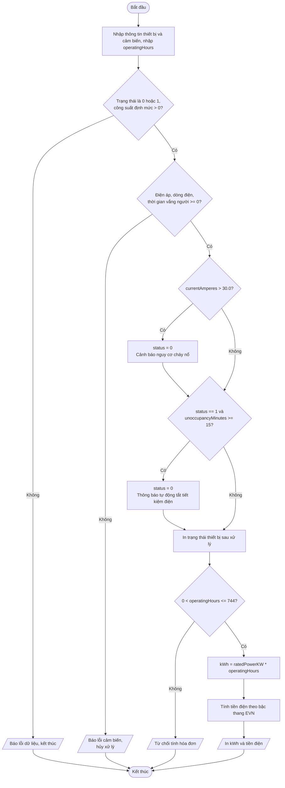

# Báo cáo phân tích và thiết kế: Module quản lý cụm thiết bị phòng thông minh

## 1. Phân tích bài toán (Input / Output)

### 1.1. Dữ liệu đầu vào

| Nhóm | Biến | Kiểu | Ý nghĩa | Điều kiện hợp lệ |
|------|------|------|---------|------------------|
| `struct SmartDevice device` | `device.deviceID` | `int` | Mã định danh thiết bị | Số nguyên |
| | `device.deviceName` | `char[50]` | Tên thiết bị (có thể có khoảng trắng, nhập bằng `fgets`) | Không rỗng |
| | `device.status` | `int` | 1: đang bật, 0: đã tắt | Chỉ nhận 0 hoặc 1 |
| | `device.ratedPowerKW` | `float` | Công suất định mức (kW) | > 0 |
| `struct EnergySensor sensor` | `sensor.voltageVolts` | `float` | Điện áp đo được (V) | >= 0 |
| | `sensor.currentAmperes` | `float` | Dòng điện đo được (A) | >= 0 |
| | `sensor.unoccupancyMinutes` | `int` | Thời gian vắng người (phút) | >= 0 |
| Biến phụ trợ | `operatingHours` | `float` | Số giờ vận hành trong tháng | > 0 và <= 744 |

### 1.2. Kết quả đầu ra

- Trạng thái thiết bị sau khi áp dụng các luật tự động hóa (`DANG BAT` hoặc `DA TAT`).
- Thông báo cảnh báo nếu có: ngắt khẩn cấp do quá tải, hoặc tự động tắt do phòng trống.
- Tổng điện năng tiêu thụ (kWh) và số tiền điện phải trả (VNĐ, chưa gồm VAT).
- Thông báo lỗi nếu dữ liệu cảm biến âm hoặc số giờ vận hành không hợp lệ.

## 2. Đề xuất giải pháp

### 2.1. Dùng toán tử `.` để truy xuất thành phần struct

Chương trình khai báo đúng 2 biến cấu trúc đơn lẻ (không dùng mảng cấu trúc, không dùng hàm tự định nghĩa). Mọi thuộc tính đều truy cập trực tiếp qua toán tử `.`:

- **Nhập liệu:** `scanf("%f", &sensor.currentAmperes)` lấy địa chỉ của member rồi ghi giá trị vào.
- **Kiểm tra an toàn:** `sensor.currentAmperes > 30.0f` đọc dữ liệu của cảm biến, còn `device.status = 0` ghi lên struct của thiết bị. Hai struct khác nhau được phối hợp trong cùng một điều kiện, ví dụ `device.status == 1 && sensor.unoccupancyMinutes >= 15`.
- **Tính tiền:** `device.ratedPowerKW * operatingHours` lấy công suất từ struct thiết bị nhân với số giờ do người dùng nhập.

### 2.2. Thứ tự ưu tiên xử lý

1. **Kiểm tra dữ liệu cảm biến trước tiên.** Dữ liệu âm là dấu hiệu lỗi phần cứng nên không có cơ sở để ra quyết định an toàn, phải hủy xử lý.
2. **Quá tải dòng điện (ưu tiên cao nhất):** `currentAmperes > 30.0` thì ngắt khẩn cấp (`status = 0`) và cảnh báo nguy cơ cháy nổ.
3. **Tiết kiệm năng lượng:** nếu thiết bị vẫn đang bật (`status == 1`) và vắng người từ 15 phút trở lên thì tự động tắt. Vì kiểm tra `status == 1` nên nếu thiết bị đã bị ngắt ở bước 2 thì không báo trùng.
4. **Tính điện năng và tiền điện** sau khi đã kiểm tra số giờ vận hành. Hóa đơn tính theo số giờ vận hành người dùng khai báo, không phụ thuộc trạng thái hiện tại của thiết bị.

### 2.3. Công thức bậc thang EVN

`kWh = ratedPowerKW * operatingHours`

| Điều kiện | Tiền điện |
|-----------|-----------|
| kWh <= 50 | `kWh * 1806` |
| 50 < kWh <= 100 | `50 * 1806 + (kWh - 50) * 1866` |
| 100 < kWh <= 200 | `50 * 1806 + 50 * 1866 + (kWh - 100) * 2167` |
| kWh > 200 | `50 * 1806 + 50 * 1866 + 100 * 2167 + (kWh - 200) * 2729` |

Tiền điện dùng kiểu `double` để không mất độ chính xác khi nhân với số lớn.

## 3. Sơ đồ các bước xử lý

## 4. Kiểm soát lỗi dữ liệu

| Lỗi | Cách xử lý trong mã nguồn |
|-----|---------------------------|
| Điện áp, dòng điện hoặc thời gian vắng người âm | Kiểm tra ngay sau khi nhập và trước mọi phép tính. Nếu sai thì in `[LOI CAM BIEN]` rồi `return 1` (hủy xử lý). |
| `operatingHours <= 0` hoặc `> 744` | Từ chối tính hóa đơn, in thông báo lỗi. Phần xử lý an toàn vẫn đã được thực hiện trước đó. |
| Nhập sai kiểu dữ liệu (chữ thay cho số) | Kiểm tra giá trị trả về của `scanf` (khác 1 thì báo lỗi). |
| Bộ đệm bàn phím còn ký tự `\n` | Làm sạch bằng `while ((c = getchar()) != '\n' && c != EOF);` sau mỗi `scanf`, nên `fgets` đọc tên thiết bị không bị trôi lệnh. |

## 5. Kiểm thử

Biên dịch: `gcc -Wall -Wextra -std=c11 src/main.c -o main` (không có lỗi, không có cảnh báo).

| Trường hợp | Dữ liệu vào chính | Kết quả |
|------------|-------------------|---------|
| Bình thường | 2.0 kW, 20 A, vắng 5 phút, 100 giờ | Trạng thái BẬT; 200 kWh; 400.300 VNĐ |
| Quá tải | 35 A | Cảnh báo ngắt khẩn cấp; trạng thái TẮT |
| Phòng trống | 1.5 kW, vắng 20 phút | Tự động tắt tiết kiệm điện; trạng thái TẮT |
| Cảm biến lỗi | dòng điện -3 A | Báo lỗi cảm biến, hủy xử lý |
| Giờ không hợp lệ | 800 giờ | Từ chối tính hóa đơn |
| Bậc 1 | 1.0 kW x 40 giờ = 40 kWh | 72.240 VNĐ |
| Bậc 2 | 1.0 kW x 80 giờ = 80 kWh | 146.280 VNĐ |
| Bậc 4 | 1.5 kW x 400 giờ = 600 kWh | 1.491.900 VNĐ |